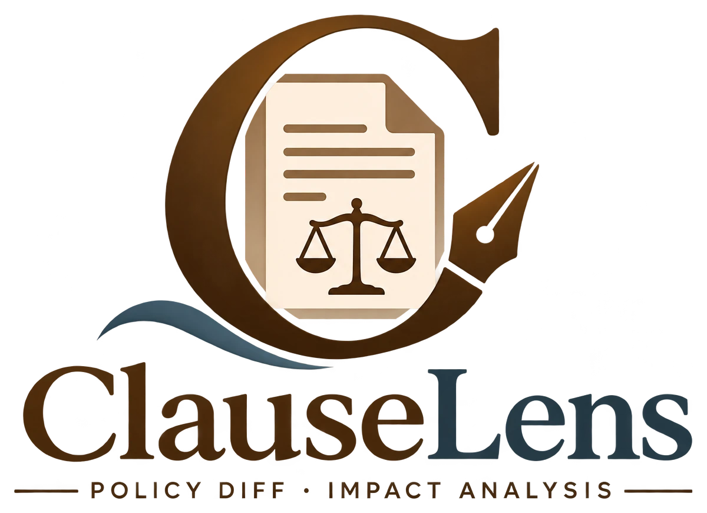

<p align="center">
  
</p>

# ClauseLens

ClauseLens compares two versions of a contract and explains, clause by clause, what
changed and who it affects.

You upload two PDFs in the browser. The models (Gemma 4 with a CUAD-fine-tuned
adapter) run on a free Kaggle GPU, and the report appears in the browser: every
changed clause side by side, with an impact summary that a second model has checked.

## Run

You need Node.js 20+, Python 3.10+ and a free, phone-verified Kaggle account.

```bash
git clone https://github.com/Rhivu10/ClauseLens.git
cd ClauseLens/clauselens-ui
python -m pip install kaggle
npm install
npm run setup
npm run dev
```

`npm run setup` checks your computer and your Kaggle account and says exactly what
to fix. The one manual step: on kaggle.com go to **Settings → API Tokens → Generate**
and save the token as `~/.kaggle/access_token`
(Windows: `C:\Users\<you>\.kaggle\access_token`).

Then open http://localhost:5173, choose the previous and the new version of a
contract, and press **Run comparison**. The changed clauses appear after about 4–7
minutes and the summaries fill in as they are written; a full run takes about 7–8
minutes for a one-page document and about 16 minutes for a 20-page contract.
Comparing the same two PDFs again opens the saved report at once.

Sample PDFs to try are in [`clauselens-ui/test-documents`](clauselens-ui/test-documents)
(Apache License 1.0 → 1.1, BSD 4-clause → 3-clause).

### Run without the web app

On any machine with a CUDA GPU (for example a Kaggle "GPU T4 x2" session):

```bash
git clone https://github.com/Rhivu10/ClauseLens.git
cd ClauseLens
python pipeline/install.py
python -m pipeline old.pdf new.pdf --out results
```

`results/` then holds `report.json`, `report.md` and `ui_data.json`. From Python:

```python
from pipeline import PipelineConfig, run_pipeline
state = run_pipeline("old.pdf", "new.pdf", PipelineConfig())
state["report"]
```

The web app runs exactly this code on Kaggle: its runner
(`clauselens-ui/server/kaggle/runner.py`) only reads the uploaded PDFs, installs with
`pipeline/install.py` and calls `run_pipeline`.

## How it works

1. **Node 1** reads both PDFs into clauses, keeping headings and numbering.
2. **Node 2** indexes every clause (embeddings, keywords, structure).
3. **Node 3** pairs each clause with its counterpart in the other version (Gemma E2B + CUAD adapter).
4. **Node 4** checks duties: shall, may, must not, and when one turns into another.
5. **Node 5** writes an impact summary per change (Gemma E4B) and a second model checks it.
6. **Node 6** builds the report: overview, changes by section and party, evidence down to the sentence.

[`pipeline/`](pipeline) connects the six nodes in one LangGraph graph; everything runs from
`.py` files.

## Documentation

- Each node: `nodes/node_N/NODE N DOCUMENTATION.md` ([Node 1](nodes/node_1), [2](nodes/node_2), [3](nodes/node_3), [4](nodes/node_4), [5](nodes/node_5), [6](nodes/node_6))
- Pipeline: [`pipeline/PIPELINE DOCUMENTATION.md`](pipeline/PIPELINE%20DOCUMENTATION.md)
- Web app and Kaggle connection: [`clauselens-ui/README.md`](clauselens-ui/README.md)
- The CUAD adapter (fine-tuned weights) and how it was trained: [`Model Finetuning/`](Model%20Finetuning)

## Repository

```
nodes/            Nodes 1–6
pipeline/         LangGraph mapping of Nodes 1–6
clauselens-ui/    web app (React + Vite) and the Kaggle runner
notebooks/        notebooks for testing and data handling only (the project runs from .py)
Model Finetuning/ the CUAD adapter weights (checkpoint-2091) and its training notebook
```

The first complete version is kept as tag [`v1.0`](https://github.com/Rhivu10/ClauseLens/tree/v1.0).
